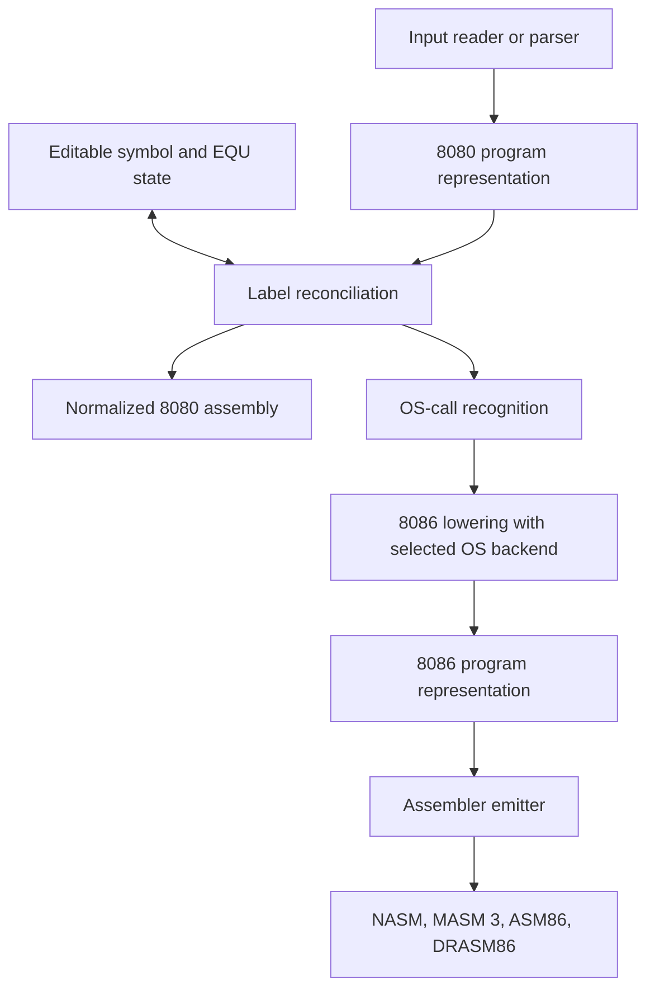

# xlt88 design

## Purpose and status

xlt88 translates 8080 programs into readable native 8086 assembly for
IBM PC DOS 1.0 and CP/M-86 1.1. This document defines the intended
architecture and interfaces. The C declarations below describe the target
contracts. They are proposals to implement incrementally.

The current implementation has an Intel source reader in `dialect.c`,
translation in `trans.c`, OS backends in `msdos.c` and `cpm86.c`,
and assembler formatting in `nasm.c`, `asm86.c` and `masm.c` (shared `asmfmt.c`). The CLI selects these implementations.
The current CLI uses an owned source program, a separate conservative
BDOS argument-recognition pass, CPU/OS lowering into an owned target program,
and NASM, ASM86 or MASM 3 rendering after lowering completes. `--emit=8080` serializes the
parsed source independently of CPU/OS lowering. Target expressions are owned trees containing copied symbol spellings and
stable source-scoped IDs. The expression emitters share parsed expression trees; NASM
renders explicit parentheses to retain grouping. EQU definitions own bound
expression trees and the source layout pass computes addresses where sizes are
known. Numeric transfers bind to unique source labels at the same offset.

The full design below remains the migration destination. Source instructions
still contain textual operand fields; full typed source nodes, generated-label
state, imported address annotations, assembler-map import, complete OS-operation
annotations, and additional readers/emitters remain future work. Unmatched
numeric transfers retain their old literal behavior and need manual review.

### Implemented interface contracts

| Entry point | Contract |
| --- | --- |
| `dialect_t.read` | Read a stream into a zero-initialized owned `source_program_t`; returns nonzero on success |
| `emit_normalized_8080` | Borrow source and streams; return nonzero on success |
| `recognize_os_calls` | Borrow source and value resolver; allocate one known-C value per record, with -1 for unknown; caller frees the array |
| `symbols_build` | Build an owned source symbol table; return nonzero on success |
| `symbols_read`, `symbols_write` | Validate/import version 1 or 2 and export version 2 state through borrowed streams; return nonzero on success |
| `lower_named` | Borrow source/shared symbol table/backend; fill an owned target; return zero on success |
| `lower_8080` | Convenience wrapper building a default symbol table before `lower_named` |
| `emit_named_8080` | Emit source with preferred symbol names; return nonzero on success |
| `target_write` | Replay borrowed immutable target events to an injected emitter; return nonzero unless target construction failed |
| `source_destroy`, `target_destroy`, `symbols_destroy` | Release owned allocations, including partial results; clear the object |

Return conventions currently preserve the existing command-status convention
for lowering and boolean convention for readers/builders. The illustrative
status enum below is still a planned unification. Emitter callbacks return
void; the stream owner must check write/close errors.

`tests/iface.c` checks source immutability across both OS lowerings,
normalized-source round trips, injected event inspection, and target rendering
after source destruction. Existing execution tests remain the semantic gate.

## Pipeline



Normalized 8080 source is a reviewable output of reconciliation. The CPU
translator consumes the same in-memory representation directly. A user
can also edit the normalized source and submit it for another translation.

### CPU and OS translation

Recognize OS operations while the original 8080 instructions and control
flow are available. For example, identifying `CALL 5` and establishing the
value in C produces a recognized BDOS operation tied to the original call.
Retain the original instruction alongside this annotation so normalized
8080 output can reproduce the source-level program.

CPU lowering and OS lowering cooperate in one ordered traversal. CPU
instructions invoke CPU lowering rules. Recognized OS operations invoke
the selected OS backend. Both append typed 8086 nodes to the same output
builder. This keeps their implementation boundaries explicit while allowing
them to share register mapping, source provenance, and label allocation.

Target-dependent details also occur in ordinary instructions. Explicit
stack selection through `LXI SP` or `SPHL` needs the CP/M-86 backend's
segment setup. Represent that requirement as a backend hook at the point
of lowering the stack operation. The CPU layer remains responsible for
8080 register and flag semantics.

Each translation invocation selects one OS target. Generating both outputs
uses the same reconciled source with two independent lowering contexts.
A target-specific lowering pass must leave the source program intact.

## Module boundaries

| Module | Input | Output | Responsibility |
| --- | --- | --- | --- |
| Reader | Source bytes and reader options | 8080 program | Dialect syntax, source locations, expressions, data declarations |
| Symbol reconciler | Program and optional symbol state | Bound symbols and references | Stable identity, preferred names, EQU dependencies, address bindings |
| 8080 emitter | Reconciled program | Normalized assembly | Readable source with consistent names and expressions |
| OS recognizer | Reconciled program | OS annotations and diagnostics | Identify BDOS, warm boot, and known function arguments |
| CPU lowering | Annotated program and target context | 8086 program | Register mapping, instruction expansion, flags, control flow |
| OS backend | Recognized operation and lowering context | 8086 nodes | Native service selection, ABI, segments, result handling |
| Assembler emitter | 8086 program and symbol table | Assembly text | Syntax, directives, operand formatting, escaping, expression rendering |
| Driver | User options | Files and status | Dependency selection, file lifecycle, diagnostics, pipeline orchestration |

Reader families cover Intel ASM, the specified MAC/RMAC dialects, Microsoft
M80 source syntax (including its macro/directive model), and binary COM.
Intel ASM is implemented; M80 has a partial flat-8080 reader. MAC/RMAC and
COM readers remain planned.
The names of concrete assembler dialects and versions must be explicit in
configuration. An `.asm` extension alone does not identify a dialect.
A CP/M-80 `.COM` reader must decode instructions and accept code/data
classification and entry-point information. Embedded data, indirect
branches, and self-modifying code can require user annotations.

The planned output families are NASM, MASM 3, ASM86, and DRASM86.
Record the precise assembler versions and executable formats as each
implementation is added. Assembly rendering and COM/CMD packaging have
separate contracts. A packaging tool may consume assembler output and
allocation metadata after assembly.

## Internal representation

Use two program representations connected by lowering. They share symbol
identities, expression types, and provenance. Each program owns its nodes
and strings. IDs refer to objects owned by that program or its associated
symbol table. Avoid storing pointers into a parser's reusable line buffer.

### 8080 program

A program contains an ordered sequence of nodes and a symbol table.

| Node kind | Required information |
| --- | --- |
| Instruction | Opcode enum, typed operands, source location |
| Label definition | Symbol ID and location in the node sequence |
| EQU definition | Symbol ID and expression ID |
| Initialized data | Element width, expression or byte-string values |
| Reserved storage | Size expression and explicit initialization policy |
| Alignment | Requested boundary and fill value |
| Origin | Address expression and address space |
| Comment | Text and source association |

An instruction operand is a register, immediate expression, direct address
expression, or register-indirect memory operand. Preserve byte and word
widths. Keep unknown or unsupported constructs as diagnostics with source
locations instead of silently omitting them.

Source provenance records a file ID and line/column for text input, or a
file ID and byte offset for binary input. Optional source addresses carry
an explicit address space. Generated instruction expansions retain their
source node ID so diagnostics and listings can trace them back.

### Expressions

Use expression nodes for integer literals, symbol references, current
location, unary operations, and binary operations. Parsers establish the
source dialect's precedence and literal rules. Operators have semantic
identities such as addition, division, bitwise AND, and shifts. Emitters
render those operators with parentheses preserving the expression tree.

Resolve expressions whose inputs are known. Retain symbolic expressions
when layout is unresolved. Report cycles, missing symbols, overflow, and
invalid arithmetic explicitly. Address-sensitive evaluation distinguishes
source addresses from generated addresses. A source absolute address must
be bound to a symbol before it can follow that symbol through translation.

### 8086 program

The output program contains typed instructions, labels, data, reservation,
alignment, origin or section requirements, and comments. Operand kinds
include registers, integers, expressions, symbolic branch targets, and
memory references. A memory reference records width, segment override,
base/index registers, and displacement expression separately.

OS lowering emits ordinary native instructions into this program. The
assembler emitter receives the completed sequence and renders it. It owns
assembler keyword escaping and directive spelling. It reports an unsupported
output construct if the chosen assembler cannot represent it.

Internal labels have identities allocated by the lowering context. Their
printed names are assigned through the symbol table, checked against user
names, and stable for identical inputs and configuration. Avoid deriving
identity from an output spelling such as `L@23`.

## Symbol and label state

The state file is both an output and an input. It enables repeated runs
with meaningful names and records the basis for address reconciliation.
Use a versioned, deterministic JSON format. Fields have explicit meanings.

| Field | Meaning |
| --- | --- |
| `schema_version` | State format version |
| `source` | Source identity, digest, reader dialect, origin and address space |
| `symbols[].id` | Stable symbol identity for this source |
| `symbols[].kind` | Code label, data label, EQU, or generated label |
| `symbols[].original_name` | Name encountered in source, if present |
| `symbols[].preferred_name` | User-editable meaningful name |
| `symbols[].source_address` | Known original offset, or null |
| `symbols[].generated_address` | Optional assembled offset and section |
| `symbols[].address_provenance` | User input, reader, or assembler listing |
| `symbols[].definition` | Source location or node association |
| `symbols[].equ_expression` | Serialized expression tree for an EQU |
| `symbols[].equ_value` | Resolved value when available, otherwise null |

Loading state binds entries to source symbols before lowering. A rename
updates emitted definitions and references through symbol IDs. The original
source name remains available for matching and diagnostics. EQU definitions
from the current source are authoritative. Imported EQU expressions and
values are checked against them and refreshed on export. Editing an EQU's
meaning is a source edit rather than an implicit effect of renaming.

For changed input, verify each imported binding against its definition.
Report stale or ambiguous entries. Reject duplicate preferred names within
the relevant namespace. Multiple labels at one address are valid aliases;
choose an explicit primary label for automatic numeric-address naming.

Exact source addresses come from the binary reader, a source layout pass,
or imported listings or user annotations. Exact generated addresses come
from the target assembler's listing or symbol map and are tied to the
assembly digest, target, and assembler configuration. Until those facilities
exist, export unknown addresses as null. Translation expansion means the
two sets of addresses can differ.

Write state atomically after a successful pipeline run. Validate path
identity so source, assembly output, and state cannot accidentally overwrite
one another. Reading and replacing the same state file is supported after
its contents have been fully loaded and validated.

### Version 2 state implementation

The current state format is a conservative subset of the full
schema above. It contains `schema_version`, `source_fingerprint`, and `symbols`.
The fingerprint is FNV-1a over parsed statement fields, including comments and
record boundaries, plus original file/line provenance when includes are used;
it is an identity check, not a security signature. IDs are
one-based definition-order indices scoped to that fingerprint. Array order is
preserved on import. Object field order is unrestricted.

Each entry contains `id`, `original_name`, `preferred_name`, `kind` (`label` or
`equ`), `definition` (expanded-record ordinal), `equ_expression` (source text or null),
`equ_value` (resolved signed source value or null), `source_address`
(known original 8080 offset or null), and `generated_address` (currently null). State uses JSON content in an 8.3 `.sym`
filename. Only preferred names may be edited. All other fields are checked
against the current source, and validation is transactional in memory.

Names newly assigned through state use at least two ASCII identifier characters
(letters/digits/underscores), beginning with a letter or underscore. Register
names and Intel expression operators are reserved. Existing source spellings
are preserved by default. Quoted strings and register operands are not renamed.
Normalized lines that exceed the current reader's 254-character limit produce
an error. State imports reject unknown fields and schema versions, duplicate
fields or names, changed definitions, and stale fingerprints.

Version 1 state is accepted with its original value/address checks and upgrades
to version 2 on export. State stores EQU source text; trees are reconstructed
and bound against current definitions on load. Source addresses are computed,
not editable. Generated offsets are never inferred from source offsets.

Changed source currently requires fresh state export. Fine-grained rebinding,
source-address import, generated symbols in state, and expression-tree
serialization remain future work. Both files are staged before
publication, but their final replacements are not one atomic transaction.

### Expression and layout implementation

`expr_t` has integer, string, symbol, location, unary, binary and list nodes.
Symbol leaves own their preferred spelling and carry `symbol_id`. Operators
have enum identities. The current grammar preserves the supported source
subset: unary `+ - ~`, HIGH/LOW extraction, multiplicative `* / % MOD SHL SHR`,
additive `+ -`, comparisons `EQ NE LT LE GT GE`, word NOT, AND, OR/XOR.
Existing symbolic shifts `<< >>` retain their earlier precedence below addition;
word shifts bind with multiplication. Symbolic XOR retains its precedence above
symbolic OR; word OR/XOR share precedence. NOT complements the low 16 bits,
and relational nodes return 65535 for true and zero for false. HIGH/LOW/NOT
lower to existing arithmetic nodes; comparisons have explicit enum identities.
NASM and normalized source renderers preserve these semantics with parentheses. Binary
operators are left associative. Parentheses override precedence. This is not
a claim of complete MAC/RMAC expression compatibility. Evaluation uses checked
host `long` arithmetic; unknown symbol/location values remain unresolved.

`layout.c` starts source layout at 100h, follows ORG, counts supported 8080
instructions and declarations, and reevaluates forward references until stable.
DB strings count bytes. DW strings have unknown size pending a dialect contract.
Unsupported constructs invalidate downstream positions until a known ORG.
EQU cycles/dependency depth are checked separately. Unstable/self-dependent
layout exports unknown addresses. Numeric branch aliases at the same address
require an explicit source name instead of an arbitrary primary label.

## Interface contracts and inversion of control

The driver is the composition root. It constructs the source reader,
reconciler, OS recognizer, CPU translator, OS backend, and assembler emitter.
Dependencies are passed through explicit contexts. Modules own no mutable
global translation state. Immutable opcode and service tables are suitable
for static storage.

The following declarations illustrate the intended boundaries. Opaque
program and builder types hide storage details. A status value reports
success, invalid input, unsupported translation, or resource/I/O failure.
A diagnostic sink receives severity, source location, and an actionable
message independently of assembly output.

```c
typedef struct source_program source_program_t;
typedef struct target_program target_program_t;
typedef struct symbol_state symbol_state_t;
typedef struct target_builder target_builder_t;
typedef struct lowering_context lowering_context_t;
typedef struct diagnostics diagnostics_t;
typedef struct input input_t;
typedef struct output output_t;
typedef struct reader_options reader_options_t;
typedef struct os_operation os_operation_t;
typedef enum status status_t;

typedef struct source_reader {
    void *context;
    status_t (*read)(void *context, input_t *input,
        const reader_options_t *options, source_program_t **program,
        diagnostics_t *diagnostics);
} source_reader_t;

typedef struct os_backend {
    void *context;
    status_t (*lower_call)(void *context, const os_operation_t *operation,
        lowering_context_t *lowering, target_builder_t *output);
    status_t (*lower_stack_selection)(void *context,
        lowering_context_t *lowering, target_builder_t *output);
} os_backend_t;

typedef struct assembler_emitter {
    void *context;
    status_t (*write)(void *context, const target_program_t *program,
        output_t *output, diagnostics_t *diagnostics);
} assembler_emitter_t;

status_t reconcile_symbols(source_program_t *program,
    const symbol_state_t *imported, diagnostics_t *diagnostics);
status_t recognize_os_calls(source_program_t *program,
    diagnostics_t *diagnostics);
status_t emit_normalized_8080(const source_program_t *program,
    output_t *output, diagnostics_t *diagnostics);
status_t lower_8080(const source_program_t *source,
    const os_backend_t *backend, target_program_t **target,
    diagnostics_t *diagnostics);
```

Readers return an owned program. Lowering returns a separately owned target
program. Provide matching destruction functions for both, including partial
results on failure. Imported state is borrowed during reconciliation;
retained names and expressions are copied into program-owned storage.
Emitter callbacks borrow complete, immutable representations for their call.
The driver owns input/output streams and checks final flush and close errors.

Streaming instruction events remain useful as a builder interface. Their
payloads must be copied if retained beyond a callback. Persistent state and
reusable target programs must contain owned data and stable IDs; function
pointers and transient symbol-resolution contexts cannot be serialized.

## Code conventions

- Use DOS/CP/M-compatible 8.3 filenames: at most eight characters before
  the dot and at most three characters in the extension. Keep directory
  names within eight characters too.

- Use lowercase identifiers with underscore separators, including functions,
  variables, fields, struct tags, enum values, macros, and module filenames.
- Every typedef name ends in `_t`, for example `source_program_t`,
  `symbol_id_t`, and `assembler_emitter_t`.
- Use meaningful names and explicit ownership. Keep interfaces small and
  pass dependencies through contexts or parameters.
- Document ABI assumptions, flag behavior, ownership, and non-obvious
  instruction expansions next to the implementation.
- Keep OS service semantics in OS modules and assembler syntax in emitters.
- Apply these conventions during the migration and to newly introduced code.
  Output-event enums and macros now follow these conventions.

## Incremental migration and acceptance

1. Stabilize the current parser/translator/emitter split. Compare generated
   binary bytes against the pre-refactor implementation and run the existing
   diagnostic, arithmetic, file-copy, and rejection tests on both targets.
2. Extract a shared symbol table and implement versioned state import/export,
   renaming, address binding, and explicit unknown addresses. Test round trips,
   aliases, conflicts, stale input, and protected output paths.
3. Replace textual operands and expressions with typed nodes. Establish
   independent reader, lowering, and emitter tests using injected test doubles.
4. Add normalized 8080 emission and verify parse/emit/parse equivalence for
   supported instructions, data, symbols, and expressions.
5. Move to an owned target program and distinct OS annotations. Verify that
   selecting a different emitter cannot change target instructions and that
   lowering for one OS cannot mutate the shared source representation.
6. Add readers and assembler flavors individually when authorized, each with
   its own fixtures and executable-output checks.

These steps preserve the current native translation approach. Complete
BDOS 2.2 and DOS 1.0 service coverage remains a separate implementation
objective tracked in `api.md`. The architecture migration supplies the
interfaces needed to extend that coverage without coupling it to input
syntax or output assembler choice.

## FCB input contract

Input FCBs always follow CP/M semantics, including for DOS output. Target
selection must not ask the caller to assert DOS layouts. FCB analysis must
bind storage, aliases, field accesses and BDOS operations before native DOS
lowering. Rewrite proven source uses into native target storage and code;
diagnose unsupported or ambiguous uses. Native DOS-layout fixtures alone do
not establish automatic CP/M source translation.

The initial fcb.c pass proves a restricted opaque-metadata subset: exact FCB
addresses at calls, dedicated DS storage, a bounded name-initialization copier,
and absence of unproved memory/control-flow escapes. Approved calls reach a
backend file_call hook; other calls keep the unsupported diagnostic. Target
storage can grow from 33 to 36 bytes, while the source and its addresses remain
unchanged. Metadata users require a later field-access transformation; they
are rejected today. Whole-program restrictions are intentional and documented
rather than treating lack of an obvious alias as proof of safety.

## Initial M80 reader

The driver injects m80_dialect through the same dialect_t interface as Intel.
The path-aware source_read entry point selects M80 preprocessing in m80.c;
stream-only readers retain the dialect_t interface, but active includes require
a source path. Raw parsing and preprocessing are separate operations.

Each expanded source_record_t owns origin_file and retains origin_line for
diagnostics. Its line field is a one-based expanded-record ordinal used by
symbol, layout and FCB analysis; it is not a physical line after expansion.
source_program_t owns the records and input-path list. source_destroy frees
both. Listing, mode and active preprocessing directives become comment records;
inactive source is omitted. LF, CRLF and bare CR are recognized; Ctrl-Z ends
CP/M text.

IF/IFT, IFE/IFF, IFDEF/IFNDEF and ELSE/ENDIF are evaluated in source order using
previous active definitions. Numeric conditions require known absolute values.
INCLUDE/.INCLUDE imports exact filenames relative to the containing source.
Conditions balance within each file; active END terminates the expanded input.
Include cycles, excessive nesting and malformed conditions are diagnosed.
The driver protects every included input from output/state-file overwrites.

Macro expansion is a reader operation implemented by macro.c through macro.h.
macro_define captures an owned body and original paths; macro_expand creates a
separate source_program_t containing substituted text and reparsed statements.
The M80 coordinator processes those records recursively through the same
conditional/include pipeline, then frees them. macro_destroy frees definitions.
No macro objects cross into CPU or OS lowering. source_record_t retains bounded
original text for lexical substitution; semantic consumers use statement fields.

Each invocation substitutes up to 32 parameters and allocates unique names for
up to 32 LOCAL declarations. Deterministic generated names use a reserved
__m80_ prefix; user symbol tokens in that namespace are rejected, including
forward references. Locals therefore cannot silently bind to source symbols.
Definition file/line provenance is retained on expanded body records; invocation
labels retain their call-site provenance. This does not yet supply a complete
expansion backtrace. Includes inside bodies resolve from the definition file.
Expansion depth is limited to 32 and the existing output record cap applies.

Repetition uses macro_block to capture a temporary owned body and
macro_iteration to substitute one item without reinterpreting it as an argument
list. The coordinator evaluates REPT counts and sequences IRP/IRPC values,
processing each expansion through the same source pipeline. A shared expansion
budget bounds even empty nested repetitions. Anonymous blocks and named macros
share the depth limit; only named macros accept initial LOCAL declarations.
Nested repetition parameter shadowing is diagnosed rather than guessed.

EXITM records the active expansion depth. Included files propagate that exit;
the owning macro or repetition consumes it. A repetition stops all remaining
iterations, while its enclosing expansion continues. Expansion-local conditional
state is discarded on exit. Substitution errors remain diagnostic records and
are reported only when active, so discarded code cannot defeat an early exit.

macro_actuals scans argument groups and escapes before splitting at commas.
A macro_eval_t callback, injected by the M80 coordinator, resolves leading
percent expressions against previously encountered absolute symbols. The macro
module does not own the symbol environment. The coordinator passes the current
radix explicitly for low-16-bit percent formatting. Quoted/grouped literal
arguments do not trigger percent evaluation.

Ampersands remain in expanded source text so nested expansion can still find
parameter boundaries. Quoted &parameter consumes the prefix when substituted.
macro_join canonicalizes final statement symbol tokens for the shared expression
parser, preserving quoted text and spaced expression operators. The canonical
names are also used for symbol/state binding and normalized 8080 output.
macro_condition validates required angle groups and compares their text without
numeric evaluation. Original file/line locations survive these operations.

SET is confined to M80 preprocessing. A mutable symbol stores a known 16-bit
absolute value and cannot change into an immutable EQU/address definition.
Assignments evaluate against the current environment. Before appending an
ordinary statement, freeze_statement replaces mutable references in expression
operands with numeric text, preserving register operands and strings. EQU values
therefore snapshot SET dependencies too. The shared source IR, layout, target
lowering and symbol-state file contain immutable expressions only. This also
keeps mutable names out of the editable label/equate table; full source-order
provenance remains on the emitted records. Forward or layout-dependent SET
assignments are diagnosed rather than deferred.

The M80 context owns radix state (initially decimal). mexpr_text normalizes
numeric literals and textual NUL before shared expression parsing or statement
emission. Nondecimal default literals gain explicit decimal suffixes, so EQU
layout, target emission, normalized source and state import never depend on a
later .RADIX directive. Mutable SET substitutions likewise carry explicit
suffixes when required. .RADIX expressions use decimal temporarily, then update
the active context only after successful validation. Includes and macro bodies
change that same context in execution order.

mexpr_number formats percent results in the active base with a leading digit.
The established explicit B/D suffix rule wins over default radix; percent
results ambiguous under that rule are rejected rather than silently reinterpreted.
Historical version-specific suffix rules and general per-operation M80 overflow
semantics still require a separate arithmetic contract and reference fixtures.
NUL consumes the rest of its expression without looking up or evaluating it.
These operations stay in the reader; the shared expression evaluator remains
checked host-long arithmetic.

Nested macro definitions, pass conditions and relocatable modules remain
unsupported. Expression grammar and symbol identity retain the shared IR
contracts rather than claiming complete M80 compatibility. The M80 reference is:
https://www.s100computers.com/Software%20Folder/Assembler%20Collection/Microsoft%20M80%20Manual.pdf

## Implemented ASM86 renderer

`asm86_render(const target_program_t *, FILE *, FILE *)` returns nonzero
on success. It borrows the immutable owned target and output/diagnostic
streams. A render-local context owns assembler aliases, deferred EQU ordering,
and branch/address counters; it is released before returning. The driver
publishes its temporary output only on success. The renderer uses
`target_write` with an injected callback, like NASM, with setup and footer
work around replay. Source records and symbol tables may already be destroyed.

ASM86-specific encoding expands conditional jumps, maps identifiers, emits
address equates for dot-memory syntax, and captures location anchors for
deferred expressions. These are assembler representation choices; CPU and
OS lowering and the semantic target events are shared. The requirement that
emitter selection preserve target instructions means preserving these events
and their behavior, not identical encoded instruction counts or addresses.

The initial validation contract is DRI ASM86 1.1N2 plus GENCMD in combined
8080 model for CP/M-86. Regression requires zero assembler diagnostics and
executed equivalence with NASM for the CPU diagnostic, console/flags,
data/alignment/memory and native FCB copies. It does not assert byte identity
or full symbolic-overflow equivalence. DRASM86 remains planned.

## MASM 3 and the shared legacy formatter

`masm_render(const target_program_t *, FILE *, FILE *)` has the same
borrowed-input, nonzero-success contract as `asm86_render`. The driver
injects the selected render function. Both delegate to `asmfmt_render`;
its per-render context contains the dialect choice, aliases, expression
anchors and jump counters. The MASM adapter stages text and converts LF to
CRLF, propagating read/write failures. Neither adapter owns or mutates the
input target or changes CPU/OS lowering.

MASM requires explicit immediate/address and direct-memory typing for forward
references, and explicit near jumps to prevent pass-dependent sizing. Its
flat offset expressions use label differences from the entry anchor. ASM86
retains OFFSET and dot-address notation. MASM reserves use DUP with a
conditional guard for zero counts; ASM86 uses RB. Assembler aliases and
semantic branch expansion remain shared.

Validation now crosses both renderers with both OS targets. MASM 3.00,
LINK 2.40 and EXE2BIN produce a COM image; CP/M targets wrap it with bin2cmd.
ASM86 1.1N2 and GENCMD produce a combined CMD; DOS tests validate the single
code-group header and extract the image above 100h into a COM. Build tools
use DOS 3.3, while DOS execution tests report version 1.0. The only accepted
linker warning is the missing STACK segment expected for COM files.
