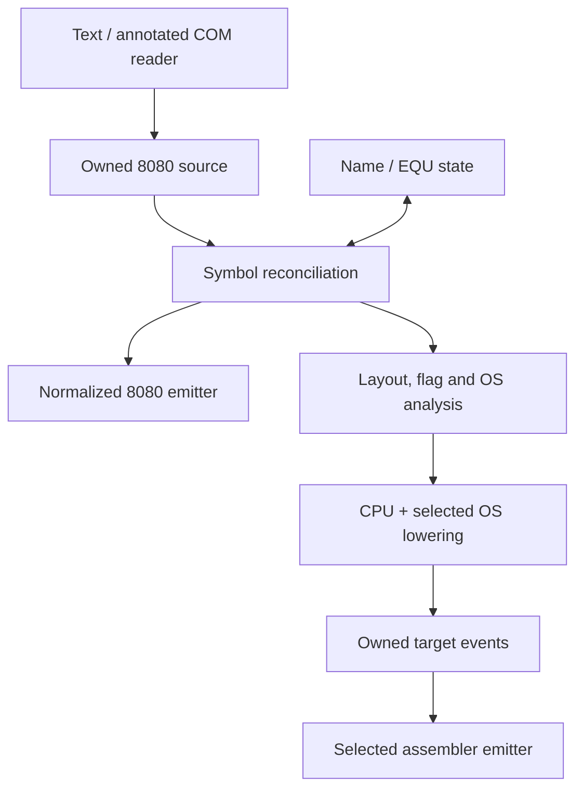

# Architecture

Headers define implemented interfaces; no speculative replacement framework.

Normalized assembly is optional output, not an internal text exchange. Source
is immutable and may be lowered independently for both OS targets.

| Module / entry | Contract |
| --- | --- |
| dialect/m80/mac/rmac: source_read | Borrow stream/path; expand into owned source_program_t |
| comread: com_read / com_analyze | Reviewed-map decoding / draft discovery; borrowed streams, owned source records |
| comhint | Bounded literal/register/stack hints; candidate discovery only, never native execution |
| symbols/state/layout | Shared names, EQU trees, source addresses and validated state |
| norm8080: emit_named_8080 | Borrow source/symbols; emit normalized CP/M ASM source |
| osrecog / flags / regions / fcb* | Owned conservative analysis plans; no application-name rules |
| trans: lower_named | Borrow source/symbols/backend; build owned target_program_t |
| cpm86/msdos/reset/conbuf | Native service ABI and stack/buffer adapters |
| target/shrink | Copy events/expressions, prove branch bounds, replay via target_write |
| nasm/asm86/masm/drasm86/asmfmt | Syntax, aliases, directives and expression rendering |
| xlt88 | Select dependencies, own streams, protect input paths and stage outputs |

source_record_t retains statement text, diagnostic, ordinal and physical
file/line. statement_t still has textual opcode/operand fields. expr_t is an
owned typed tree with symbol IDs. output_t/operand_t have typed categories,
owned expressions and some textual register/memory spellings. Source addresses
and generated addresses are distinct; unknown addresses stay explicit.

Initialize owned results to zero; destroy partial results on failure. Target
construction copies borrowed events, so rendering works after source destruction.
Emitter callback data is borrowed only during the call. Readers/builders use
nonzero success; lowering uses zero success. Stream owners check write/close
errors. Each output replacement is atomic, not the assembly/state pair together.
backend_t and emitter_t inject callbacks/context; no global mutable pipeline state.

## Maintenance and port boundaries

Internal cleanup may classify operands once, replace duplicate string parsing
or structure memory width/segment/base/displacement where useful. Remove the
old path when replacing it. Completion is unchanged behavior/ownership and
passing existing relevant tests; no new framework or test harness is needed.
This is maintenance, not an open functional milestone.

Fixed origins and known source boundaries are preserved; expansion overflow,
overlap and unknown reordered-region sizes fail. Flag analysis starts live;
unknown edges remain conservative. FCB storage/field proofs are bounded, not
whole-program alias analysis. Service selector policy is in [api.md](api.md).

Review implicit page alignment, low-byte pointer arithmetic, numeric/code
pointers, inline return-address data, self-modification, SS:SP/DI/EI, native
OS structures, BIOS/ROM/I/O and heap/stack growth. Unaligned x86 words alone
need no padding. Manual ports must state assumptions, changes and tested paths.
Compare transcripts/files, not exact assembly; preserve originals/references.
Do not turn reference patches into program-name translation rules.

Use 8.3 filenames, lowercase underscore names and `_t` typedef suffixes.
Keep ownership/interfaces explicit. Comment ABI, flags and non-obvious proofs.
OS semantics belong in backends; assembler syntax belongs in emitters.
